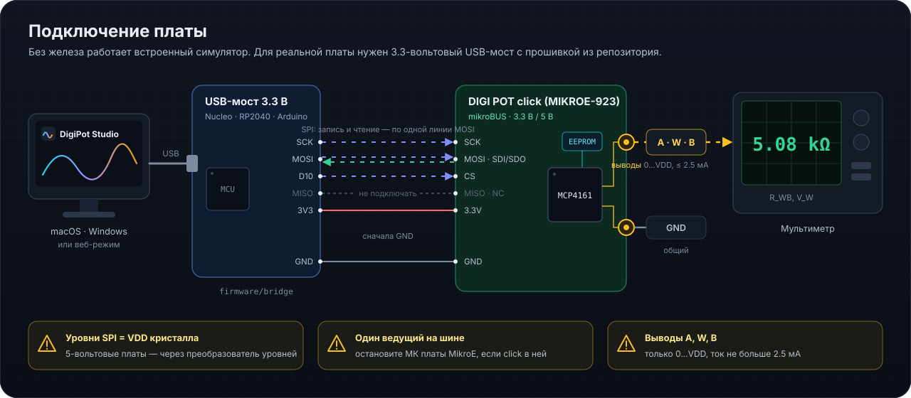
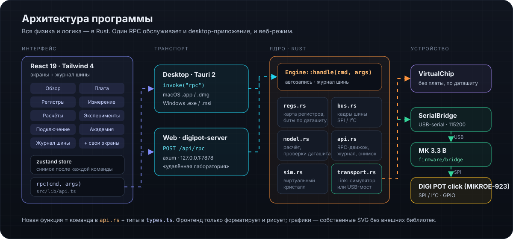

# DigiPot Studio v0.1.1

<p align="center">
  
</p>

<p align="center">
  <a href="https://github.com/maximkurein/DigiPot-Studio/actions/workflows/ci.yml"></a>
  <a href="LICENSE"></a>
  
  
  
  
</p>

<p align="center">
  <a href="#быстрый-старт"><strong>Быстрый старт</strong></a>
  &nbsp;·&nbsp; <a href="#как-работает-кристалл">Как работает кристалл</a>
  &nbsp;·&nbsp; <a href="#подключение-к-плате">Подключение</a>
  &nbsp;·&nbsp; <a href="BUILD.md">Сборка</a>
  &nbsp;·&nbsp; <a href="docs/INDEX_ru.md">Документация</a>
</p>

DigiPot Studio — настольное приложение для macOS и Windows (плюс веб-режим) для работы с платой **DIGI POT click (MikroE, MIKROE-923)** и изучения микросхемы **Microchip MCP4161** — 8-битного цифрового потенциометра с EEPROM и SPI. Вся инженерная модель написана на Rust; интерфейс — React + Tailwind в оболочке Tauri 2.

Если платы под рукой нет — встроенный **симулятор кристалла** отвечает на те же кадры SPI, что и настоящий: память 16 × 9 бит, загрузка движка из EEPROM при включении, цикл записи EEPROM с флагом EEWA, пределы инкремента/декремента и ошибки команд (CMDERR).

## Три сценария

| | Сценарий | Как |
|---|---|---|
| 🔌 | **Запустить плату** | «Плата» → «Подключение» → «Регистры → Прочитать всё». Подробно — [первый запуск](docs/FIRST_RUN_ru.md). |
| 📐 | **Рассчитать схему** | «Потенциометр»: R_AB, VDD, напряжения на A и B, нагрузка — модель считает R_WB, V_W, просадку и проверяет пределы даташита. |
| 🎓 | **Изучить микросхему** | «Обзор» объясняет каждый блок, «Академия» — 8 уроков с кнопками «попробуйте сами». |

## Как работает кристалл

Между выводами A и B — цепочка из 256 одинаковых резисторов R_S = R_AB / 256 и 257 ключей-отводов; код движка N (0…256) выбирает, какой отвод соединён с W:

```
R_WB = R_AB · N / 256 + R_W          V_W = V_B + (V_A − V_B) · N / 256
```

Пример: вариант 10 кОм (MCP4161-103), N = 200, R_W = 75 Ом → R_WB = 7.89 кОм; при V_A = 3.3 В, V_B = 0 → V_W = 2.578 В, шаг 12.9 мВ. R_AB конкретного экземпляра отличается от номинала до ±20 %, поэтому реостат требует калибровки, а делитель — нет (важно только отношение).

Команды SPI — 4 бита адреса, 2 бита операции и 10 бит данных; инкремент и декремент — один байт. Положение движка при включении хранится в EEPROM (адрес 02h): каждая запись занимает до 10 мс и расходует один цикл из ~1 млн.

## Возможности

| Раздел | Что умеет |
|---|---|
| **Потенциометр** | Ползунок 0…256, шаги ± командами инкремента/декремента, схема с кликабельными ключами TCON, кривые R_WB/R_WA и V_W (с нагрузкой и полосой ±1 LSB), подбор кода по R или V, «мультиметр» симулятора |
| **Обзор** | Живая блок-схема MCP4161, поля регистров каждого блока, предупреждения модели |
| **EEPROM** | Положение при включении, 10 ячеек данных, запись только с подтверждением, счётчик циклов, цикл питания в симуляторе |
| **Регистры** | Карта 14 регистров по битам, редакторы полей, запись/чтение, сравнение readback, экспорт/импорт |
| **Плата** | Ряды mikroBUS с используемыми выводами, выводы потенциометра, питание, чек-лист и правила безопасности |
| **Подключение** | Симулятор или USB-мост с 3-проводным чтением, сканер USB, схема проводов |
| **Академия** | Уроки: принцип, реостат и делитель, команды SPI, чтение по одной линии, EEPROM, TCON, допуски, пределы |
| **Журнал шины** | Каждый кадр с расшифровкой изменённых полей и пояснениями симулятора (⌘/Ctrl + J) |
| **О программе** | Версия и дата выпуска, разработчик, лицензия, ссылки на репозитории с копированием `git clone`, условия использования |

## Быстрый старт

```bash
git clone https://github.com/maximkurein/DigiPot-Studio.git
cd DigiPot-Studio
npm ci
npm run app        # desktop-приложение (Tauri, hot reload)
```

Нативный интерфейс на egui (без WebView и Node, в разработке рядом с Tauri): `make egui` или `cargo run -p digipot-egui --release`. Он использует то же ядро и тот же файл настроек, что и Tauri-приложение. Как он устроен, с примерами кода — [EGUI.md](EGUI.md). Перенести так же другой Tauri-проект — скил [`tauri-to-egui`](.claude/skills/tauri-to-egui/README.md) и промт [PROMPT_TAURI_TO_EGUI.md](PROMPT_TAURI_TO_EGUI.md).

Веб-режим (удалённая лаборатория): `npm run web` → http://127.0.0.1:7878. Проверка модели из консоли: `cargo run -p digipot-core --example probe -- 200`.

| Клавиши | Действие |
|---|---|
| <kbd>⌘/Ctrl</kbd> + <kbd>1</kbd>…<kbd>8</kbd> | переключение экранов |
| <kbd>⌘/Ctrl</kbd> + <kbd>J</kbd> | журнал шины |

## Подключение к плате

<p align="center">
  
</p>

У MCP4161 один вывод данных SDI/SDO, и на click он подключён к линии **MOSI**; **MISO помечен NC**. Запись работает с любым мастером SPI, а чтение — по 3-проводной схеме: мост выдаёт 6 бит команды, отпускает линию и принимает ответ по ней же (команда моста `T`). Подробно — [docs/BRIDGE_ru.md](docs/BRIDGE_ru.md).

> [!WARNING]
> Уровни SPI равны VDD кристалла: при питании 3.3 В 5-вольтовые платы — только через преобразователь уровней. Если click стоит в отладочной плате MikroE, её микроконтроллер тоже мастер SPI — остановите его. Напряжения на A, W, B — только 0…VDD, ток — не больше 2.5 мА.

## Что проверить на своей плате

- **Вариант R_AB** (5/10/50/100 кОм) — по маркировке U1; по умолчанию в приложении 10 кОм.
- **От чего питается кристалл** (3.3 или 5 В) — от этого зависят допустимые напряжения на выводах.
- **Порядок контактов** выводов потенциометра — по шелкографии.

## Архитектура программы

<p align="center">
  
</p>

```
crates/digipot-core     Rust: регистры, кадры SPI, модель, симулятор, транспорт, RPC-движок
crates/digipot-server   HTTP-сервер (веб-режим): та же RPC + раздача интерфейса
src-tauri/              desktop-оболочка Tauri 2
crates/digipot-egui     нативный интерфейс на egui/eframe (все экраны, без WebView)
src/                    интерфейс React 19 + Tailwind 4
firmware/bridge/        прошивка USB-моста (Arduino-совместимые платы 3.3 В)
```

## Сборка и версии

| Платформа | Команда | Результат |
|---|---|---|
| macOS | `python3 build_macos.py [--universal]` | `.dmg` и `.app.zip` в `release/vX.Y.Z/` |
| macOS, egui | `python3 build_macos.py --egui [--universal]` | `DigiPot-Studio-egui-….dmg` и `.app.zip` |
| Windows | `.\build_windows.ps1` | NSIS `.exe` и `.msi` в `release\vX.Y.Z\` |
| Веб | `make build-web` | `dist/` + `digipot-server` |

Версия — только через `python3 tools/update_version.py` ([VERSION_MANAGEMENT.md](VERSION_MANAGEMENT.md)). Подробно о сборке — [BUILD.md](BUILD.md).

## Документация

- [Первый запуск с платой](docs/FIRST_RUN_ru.md)
- [USB-мост: прошивка, схема, протокол](docs/BRIDGE_ru.md)
- [Архитектура кода](docs/ARCHITECTURE_ru.md)
- [Выпуск релиза](docs/release_guide_ru.md)

## Ограничения

- Модель — инженерное приближение по даташиту DS22059B (типовые значения R_W, температурный коэффициент, полоса); для точных применений калибруйте по измерениям.
- WiperLock и защита записи требуют высокого напряжения на CS — на click они недоступны и только отображаются.
- Приложение не подписано сертификатом разработчика: macOS и Windows покажут предупреждение при первом запуске.

## Репозитории

| | Адрес | Для чего |
|---|---|---|
| GitHub | <https://github.com/maximkurein/DigiPot-Studio> | основной: релизы, CI, issue |
| Forgejo | <http://100.64.0.12:3000/mxm/DigiPot-Studio> | зеркало в локальной сети лаборатории |

```bash
git remote add origin  https://github.com/maximkurein/DigiPot-Studio.git
git remote add forgejo http://100.64.0.12:3000/mxm/DigiPot-Studio.git
git push origin main && git push forgejo main
```

Те же ссылки доступны в самом приложении — экран «О программе» (<kbd>⌘/Ctrl</kbd> + <kbd>8</kbd>).

## Автор и лицензия

Разработчик — **Kurein M N**. Лицензия — [MIT](LICENSE).
