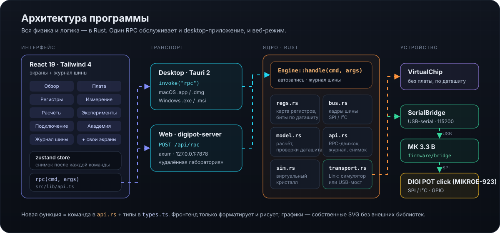

# Архитектура кода

  

## Один RPC

Весь бэкенд — `Engine::handle(cmd, args) -> json` в `crates/digipot-core/src/api.rs`. Его вызывают три способа запуска:

| Запуск | Интерфейс | Как доходит до движка |
|---|---|---|
| Desktop (Tauri 2) | React (`src`) в WebView | команда Tauri `rpc` |
| Веб-режим (`digipot-server`) | React (`src`) в браузере | `POST /api/rpc` |
| Нативный (`digipot-egui`) | egui/eframe | `Engine::handle` напрямую, из отдельного потока движка |

React-интерфейс вызывает `rpc()` из `src/lib/api.ts` и не знает, какой транспорт работает. Правила ядра (EEPROM только через `nv_write {confirm: true}`, автозапись только WIPER0/TCON) действуют одинаково во всех трёх.

Новая функция = новая ветка `match cmd` в `api.rs` + типы в `src/lib/types.ts` + вызов `useStore().call()` + экран или кнопка в egui (`sh.rpc(...)`).

## Ядро (`crates/digipot-core`)

| Модуль | Ответственность |
|---|---|
| `regs.rs` | память MCP4161 (16 × 9 бит, Table 4-1): WIPER0, NV_WIPER0, TCON, STATUS, ячейки 06h…0Fh; поля по даташиту; `nv()` отмечает EEPROM, которую автозапись не трогает |
| `bus.rs` | команды MCP4161 (адрес 4 + операция 2 + данные 10; инкремент/декремент — 1 байт), разбор кадра, CMDERR, 3-проводное чтение (`Frame::Spi3`) |
| `model.rs` | R_WB/R_WA, V_W с нагрузкой (узловой анализ), шаги, ток, полоса, температура; кривые по всем кодам; предупреждения по пределам даташита |
| `sim.rs` | виртуальный MCP4161: POR из EEPROM, цикл записи EEPROM (EEWA), пределы инкремента, CMDERR, конфликт на SDI/SDO при полнодуплексном чтении, «мультиметр» с R_AB экземпляра |
| `transport.rs` | симулятор, USB-мост (команды `S` и `T`), список портов, сканер USB |
| `about.rs` | сведения о программе (имя, версия, дата выпуска, разработчик, лицензия, ссылки на репозитории) — синхронизируется из `config/version.json`, отдаётся в `get_meta` как `meta.app` |
| `api.rs` | движок: автозапись WIPER0/TCON, `step`, `goto`, `nv_write` (только с `confirm`), `power_cycle`, `curve`, журнал шины, сохранение настроек |

## Интерфейс React (`src`)

- `lib/store.ts` — состояние (zustand): снимок после каждой команды, опрос статуса раз в 350 мс, журнал.
- `components/fields.tsx` — редактор любого поля по метаданным из Rust.
- `lib/blocks.ts` — блоки схемы на экране «Обзор»; `id` совпадает с `FieldDef.block`.
- `lib/board.ts` — факты о плате; `lib/lessons.ts` — уроки «Академии».
- `views/*View.tsx` — экраны; `components/Plot.tsx` — графики (SVG, лог-оси, две оси Y).
- `views/AboutView.tsx` — «О программе»: всё берётся из `meta.app`; внешние ссылки открываются через `openUrl()` (в Tauri — команда `open_url`, пропускает только http/https; в браузере — `window.open`).

## Нативный интерфейс (`crates/digipot-egui`)

Подробно, с примерами кода — [EGUI.md](../EGUI.md).

- `app.rs` — оболочка: навигация, верхняя панель, журнал шины, тосты. Экраны получают `&Shared` (снимок `State` от ядра) и ставят действия `Act` в очередь; оболочка выполняет их после кадра.
- `worker.rs` — поток движка: задания `Job` по каналу, публикация `State`, новых записей журнала и ответов раз в кадр; при простое — каждые 350 мс; подряд идущие `set_field` одного поля сливаются.
- `views/*.rs` — те же 8 экранов, что в React; `content.rs` — тексты блоков, платы и уроков (зеркало `blocks.ts`, `board.ts`, `lessons.ts`).
- `theme.rs` — цвета из CSS-переменных веб-версии, тёмная и светлая темы; `canvas.rs` — схемы в координатах SVG; графики — `egui_plot`.
- `shots.rs` — `make egui-shots`: обход всех экранов со снимками для проверки вёрстки.
- Файл настроек общий с Tauri-приложением; сборка `.app`/`.dmg` — `python3 build_macos.py --egui`.

## Тесты

`cargo test -p digipot-core`: поля не перекрываются, значения сброса совпадают с даташитом, битовые строки команд — с Table 7-2, симулятор соблюдает POR, EEWA, пределы инкремента и CMDERR, формулы модели — с Equation 5-2, RPC и экспорт/импорт работают.

`cargo test -p digipot-egui`: форматирование чисел, задания выполняются в потоке движка, запись EEPROM без подтверждения возвращается ошибкой, журнал сбрасывается после `clear_log`, слияние заданий не переставляет команды разных типов.
