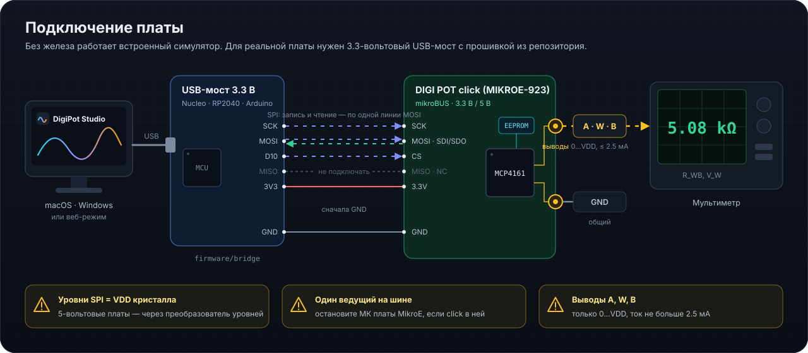

# USB-мост: прошивка, схема, протокол

  

> [!WARNING]
> Уровни SPI равны VDD кристалла. При питании 3.3 В 5-вольтовые Arduino (Uno/Mega/Nano classic) — только через преобразователь уровней. Если click установлен в отладочную плату MikroE, её микроконтроллер тоже мастер SPI: остановите его программу или выньте click.

## Подходящие платы

Raspberry Pi Pico (arduino-pico), STM32 Nucleo (STM32duino), ESP32, Arduino Zero/Due/Nano 33 — любые Arduino-совместимые с выводами 3.3 В. Прошивка: `firmware/bridge/bridge.ino` (Arduino IDE или arduino-cli).

## Провода

| Мост | Click (mikroBUS) | Назначение |
|---|---|---|
| GND | GND | общий провод — первым |
| 3V3 | 3.3V | питание (или 5V — проверьте, от чего питается кристалл) |
| SCK | SCK | такт |
| MOSI | MOSI | SDI/SDO кристалла: запись и чтение |
| D10 | CS | выбор кристалла, активный 0 |
| MISO | — | на click не разведён (NC), не подключать |

Номера выводов меняются в начале `bridge.ino`: `PIN_CS`, `PIN_SCK`, `PIN_MOSI`.

## Чтение по одной линии

У MCP41X1 вывод SDI/SDO общий, на click он подключён к MOSI. Команда `T` читает по 3-проводной схеме (DS22059B, Figure 6-1): мост программно (bit-bang, режим 0, ~100 кГц) выдаёт первые 6 бит — адрес и код чтения `11`, сразу после фронта шестого такта переводит MOSI во вход с подтяжкой и принимает остальные 10 бит от кристалла. Без внешнего подтягивающего резистора частота чтения не должна превышать 250 кГц (вывод — открытый сток со слабой подтяжкой). После команды SPI-периферия восстанавливается.

Пример: чтение движка (адрес 00h) — `T 0CFF 6` → `OK 0E80` (CMDERR = 1, значение 080h). Если бит CMDERR (бит 9 ответа) равен 0, кристалл отклонил команду — например, идёт запись EEPROM.

## Протокол

115200 8N1, одна команда в строке, ответ заканчивается `\n`; строки, начинающиеся с `#`, — комментарии.

| Команда | Ответ | Назначение |
|---|---|---|
| `?` | `BRIDGE 1 <плата> spi,spi3,i2c,gpio` | опознание |
| `CFG <гц> <режим>` | `OK` | частота и режим SPI (0–3) |
| `S <hex>` | `OK <hex>` | кадр SPI, CS = 0 на весь кадр (запись, инкремент, декремент) |
| `T <hex> <бит>` | `OK <hex>` | 3-проводное чтение: выдать `<бит>` бит, затем слушать линию MOSI |
| `IW`, `IR`, `P`, `G` | | I²C и выводы — для этой платы не нужны |

Проверка вручную: откройте порт в любом терминале (`screen /dev/cu.usbmodem* 115200`) и отправьте `?`, затем `S 0040` (движок на 040h) и `T 0CFF 6`.
