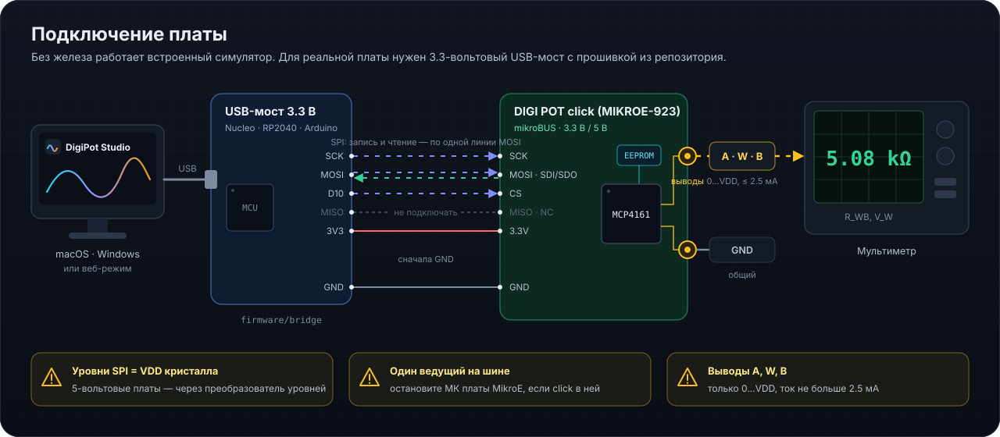

# Первый запуск с платой DIGI POT click (MIKROE-923)

  

## 1. Без платы

Запустите приложение (`npm run app`, нативный интерфейс — `make egui`, или установщик из Releases). По умолчанию подключён **симулятор** MCP4161: все экраны работают, журнал шины (⌘/Ctrl + J) показывает кадры, которые ушли бы в кристалл, и пояснения, если кристалл отверг бы команду.

## 2. Подготовка платы

1. Прочитайте маркировку U1 и выберите вариант R_AB в «Потенциометр → Схема включения» (502 = 5 кОм, 103 = 10 кОм, 503 = 50 кОм, 104 = 100 кОм).
2. Выясните, от какого напряжения питается кристалл (3.3 или 5 В), и задайте VDD.
3. Если click стоит в отладочной плате MikroE — остановите её микроконтроллер или выньте click: мастер SPI должен быть один.

## 3. USB-мост

1. Прошейте `firmware/bridge/bridge.ino` в плату с логикой 3.3 В (см. [BRIDGE_ru.md](BRIDGE_ru.md)).
2. Соедините GND, 3.3V, SCK, MOSI, CS — сначала GND. MISO не нужен.
3. «Подключение» → выберите порт → «Подключить». Приложение прочитает EEPROM и запишет WIPER0 и TCON.

## 4. Проверка связи

«Регистры» → «Прочитать всё»: STATUS = 1E0h, TCON = 1FFh, WIPER0 — как записано (зелёная отметка «чтение ✓»). Затем подайте на A и B напряжения в пределах 0…VDD и проверьте V_W мультиметром на кодах 0, 128, 256.

## Если что-то не так

| Симптом | Причина |
|---|---|
| «нет ответа BRIDGE» | не та прошивка, другой baud, плата с авто-сбросом не успела загрузиться |
| чтение возвращает одни единицы (STATUS = 1FFh) | линию никто не ведёт: нет питания click, CS не доходит, MOSI не подключён |
| «CMDERR — команда отклонена» | идёт запись EEPROM (подождите 10 мс) или команда недопустима для адреса |
| «мост без команды T» | старая прошивка моста — прошейте `bridge.ino` из этого репозитория |
| движок не двигается | второй мастер на шине (плата MikroE), неверный режим SPI, CS не доходит |
| V_W не совпадает с моделью | ключи TCON разомкнуты, нагрузка на W, другой вариант R_AB или VDD |
