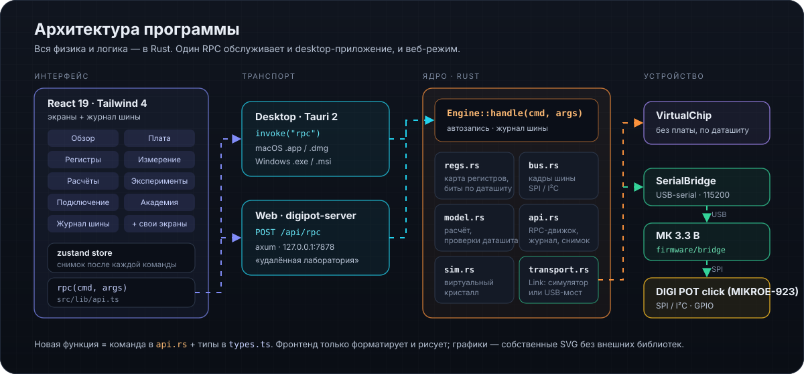

# Документация DigiPot Studio

  

| Руководство | О чём |
|---|---|
| [Первый запуск](FIRST_RUN_ru.md) | от распаковки платы до первой записанной конфигурации |
| [USB-мост](BRIDGE_ru.md) | прошивка, схема проводов, протокол `BRIDGE` |
| [Архитектура](ARCHITECTURE_ru.md) | как устроен код: ядро Rust, RPC, интерфейсы React и egui |
| [Нативный интерфейс egui](../EGUI.md) | как устроен `crates/digipot-egui`, с примерами кода |
| [Выпуск релиза](release_guide_ru.md) | версия, тег, сборка, публикация |
| [Сборка](../BUILD.md) | macOS, Windows, веб |
| [Версии](../VERSION_MANAGEMENT.md) | единый источник версии и чек-лист |
| [Перенос Tauri → egui](../PROMPT_TAURI_TO_EGUI.md) | промт для ИИ и скил `tauri-to-egui` для других проектов |

Первоисточники: даташит MCP4161 и руководство пользователя DIGI POT click (MIKROE-923) (Microchip). PDF в репозиторий не кладём — только ссылки.
